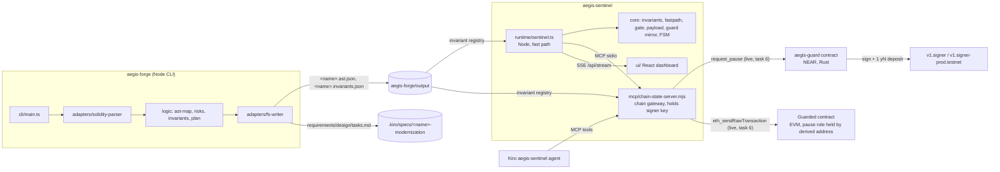

# Design Document: AEGIS Protocol

## Overview

AEGIS CREW has two applications that share one spec and one set of rules.

- **Aegis Forge** (`aegis-forge/`) reads a legacy Solidity file and writes three things: a JSON AST map, a list of detected risks, and a Kiro modernization spec. It also proposes invariants that the Sentinel can register.
- **Aegis Sentinel** (`aegis-sentinel/`) watches guarded contracts. A Node runtime evaluates invariants against live chain state. On a breach, it asks an on-chain guard contract on NEAR to have Chain Signatures sign a `pause()` transaction, then broadcasts the signed transaction to the target chain. A React dashboard shows the state.

Both apps follow `.kiro/steering/architecture.md`: deterministic logic lives in a pure core, and every side effect lives in an adapter. The UI follows `.kiro/steering/ui-manifesto.md`.

### Design decisions

| Decision | Choice | Reason |
|---|---|---|
| Who signs on breach | An on-chain **Aegis Guard** contract on NEAR calls the MPC `sign` method | The MPC `sign` method requires an attached deposit, and NEAR function-call keys cannot attach deposits. A contract can pay the deposit and enforce the allowlist and `pause()` selector on-chain (Requirements 2.7–2.9). |
| Where the signer key lives | Only in the chain-state MCP server process (Node, live mode), read from `.env` | No tool returns it, so it never reaches an agent's context; a key in a Vite bundle would be public, and the browser bundle contains no chain or signer code (2.11). |
| Who meets the 500ms budget | The deterministic runtime, not an LLM agent | One LLM turn takes seconds. The Kiro `aegis-sentinel` agent supervises every 60s (`.kiro/crew.yaml`). |
| What the 500ms covers | `t0` → NEAR sign transaction submitted | MPC signatures arrive asynchronously over several NEAR blocks (Open Question 1 in requirements). |
| Target-chain transaction | EIP-1559 (type 2), with `chainId` | EIP-155 replay protection. One derivation path per guarded contract and chain, as NEAR's docs recommend. |
| Invariant engine location | `aegis-sentinel/src/core/invariants/` | The Sentinel evaluates invariants. The Forge emits invariant *definitions* as JSON data, so no code is shared between apps. |
| Amounts | `bigint` everywhere; decimal strings on the wire | No precision loss (Requirement 1.9). |

## Architecture



### Layers and paths

| Layer | Forge | Sentinel |
|---|---|---|
| Pure core | `src/logic/` | `src/core/` |
| Adapters | `src/adapters/` | `src/adapters/chain/` (MCP client), `src/adapters/config/`, `src/adapters/crypto/`, `src/adapters/feed/`, `src/adapters/mock/`, `src/adapters/audio/` (planned) |
| Entry points | `src/cli/` | `src/runtime/` (Node), `src/main.tsx` (browser composition root), `mcp/` (MCP server) |
| Presentation | — | `src/ui/` |
| On-chain | — | `contracts/aegis-guard/` (Rust, near-sdk) |

The browser bundle imports `src/core/`, `src/ui/`, `src/adapters/feed/`, and `src/adapters/mock/` only. It never imports `src/adapters/{chain,config,crypto}/`, `src/runtime/`, or `mcp/` (enforced by `tsconfig.json` excludes and a bundle check).

## Components and Interfaces

### Sentinel pure core (`aegis-sentinel/src/core/`)

**`model.ts`**: shared domain types (see Data Models).

**`invariants/engine.ts`** (Requirement 1)

```ts
type Result<T, E> = { ok: true; value: T } | { ok: false; error: E };

interface TokenState { readonly balances: ReadonlyMap<Address, bigint>; readonly totalSupply: bigint }
type Transition =
  | { kind: 'transfer'; from: Address; to: Address; amount: bigint }
  | { kind: 'mint'; to: Address; amount: bigint }
  | { kind: 'burn'; from: Address; amount: bigint };

interface InvariantViolation {
  invariantId: string; transition: Transition;
  pre: { sumBalances: bigint; totalSupply: bigint };
  post: { sumBalances: bigint; totalSupply: bigint };
}

function evaluate(state: TokenState, registry: InvariantRegistry): InvariantReading[];
function applyTransition(state: TokenState, t: Transition, registry: InvariantRegistry):
  Result<TokenState, InvariantViolation>;   // on error, the caller keeps `state` (1.2)
```

`applyTransition` computes the post-state, runs every registered invariant (1.1), rejects negative balances (1.4), and returns the violation as a value (1.3). For live contracts the Sentinel cannot reject a transaction that already happened. There, `evaluate` runs on each observed post-state, and a `breached` reading is the critical PBT failure that starts Requirement 2.

**`mitigation/gate.ts`** (2.8, 2.9, 2.16)

```ts
const PAUSE_SELECTOR = '0x8456cb59'; // bytes4(keccak256("pause()"))
function approveSignRequest(intent: PauseIntent, allowlist: Allowlist): Result<ApprovedIntent, GateRefusal>;
```

It approves only if `intent.to` and `intent.chainId` match the allowlist entry for `intent.contractId` (address compared case-insensitively), `intent.data` equals `PAUSE_SELECTOR` (case-insensitive hex), and `intent.value === 0n`. The chain check prevents a signature intended for one chain from being requested for another.

**`mitigation/payload.ts`** (2.1, 2.15)

```ts
function formatPauseIntent(entry: GuardedContract, prefetch: EvmPrefetch): PauseIntent;
function encodeEip1559Unsigned(intent: PauseIntent): Result<Uint8Array, EncodeError>;   // RLP, type 0x02
function encodeEip1559Signed(intent: PauseIntent, sig: EcdsaSignature): Result<Uint8Array, EncodeError>;
function decodeEip1559(bytes: Uint8Array): Result<DecodedEip1559, string>;              // strict, canonical only
```

`EvmPrefetch` (nonce, `maxFeePerGas`, `maxPriorityFeePerGas`) is refreshed by an adapter on every target-chain block, so formatting needs no network call. Out-of-range fields (nonce, chain ID, and gas limit above 2^64−1; fees above 2^256−1) are returned as `EncodeError` values. RLP lives in `core/rlp.ts`; keccak hashing stays in adapters (and tests), so the core imports no libraries.

The Rust side is `contracts/pause-tx`, a crate built on NEAR's `omni-transaction` (the library the guard contract will use). Its `vectors` binary writes `tests/vectors/eip1559-pause.json`, and the Sentinel encoder must match it byte for byte. Writing it surfaced one real issue: `omni-transaction` appends signature `r` and `s` as raw 32-byte strings, so a signature with a leading zero byte (about 1 in 128) would encode non-canonically and Ethereum nodes would reject the transaction. The crate strips leading zeros before encoding, and the vectors include such signatures.

**`mitigation/fsm.ts`** (2.3, 2.12, 2.13, 2.14)

```ts
type MitigationState = 'none' | 'pending_signature' | 'signed' | 'broadcast' | 'confirmed' | 'failed' | 'refused';
type MitigationEvent =
  | { kind: 'breach_detected'; breachId: string; readAtMs: number; nowMs: number }
  | { kind: 'gate_refused'; reason: string; nowMs: number }
  | { kind: 'sign_submitted'; nearTxHash: string; nowMs: number }
  | { kind: 'signature_received'; signature: EcdsaSignature; nowMs: number }
  | { kind: 'broadcast'; targetTxHash: string; nowMs: number }
  | { kind: 'confirmed'; nowMs: number }
  | { kind: 'timeout'; nowMs: number }
  | { kind: 'paused_observed'; nowMs: number };
type Command =
  | { kind: 'reread_state' } | { kind: 'submit_sign'; attempt: number }
  | { kind: 'broadcast'; signature: EcdsaSignature } | { kind: 'alert'; reason: string };

interface MitigationMachine { contractId: string; paused: boolean; breachId?: string; lastSignCommandAtMs?: number; mitigation: Mitigation }
function step(m: MitigationMachine, e: MitigationEvent, cfg: MitigationConfig): { next: MitigationMachine; commands: readonly Command[] };
```

The state machine is the only place mitigation policy lives. It returns a list of commands (empty means do nothing), because a retry needs both `submit_sign` and `alert`:

- A breach moves straight to `pending_signature` and issues `submit_sign` (attempt 1), so a second breach arriving before the NEAR transaction lands is already blocked (2.12).
- A breach while a mitigation is in flight or confirmed issues nothing (2.12).
- A paused contract issues nothing, including retries (2.13).
- A breach older than `MAX_STATE_AGE_MS` issues `reread_state` (2.14).
- `timeout` is a timer tick. The core checks that `signatureTimeoutMs` has really elapsed since the last `submit_sign`. The first expiry issues `submit_sign` (attempt 2) plus `alert`; the next moves to `failed` (2.3).
- Events that do not apply in the current state are ignored.
- Every transition records its timestamp in `timeline` (2.4); `signRequestSubmitted` keeps the first submission, which is the 2.1 latency metric.

**`severity.ts`** (2.17): `contractSeverity(c): 'nominal' | 'critical' | 'contained'` and `overallSeverity(snapshot)`. The UI uses Acid Green only when severity is `critical`.

**`format.ts`**: deterministic display formatting (`formatAmount`, `formatDelta`, `shortAddress`, `formatMs`). It does not depend on locale.

### Sentinel adapters

Live-mode adapters (planned, task 6) and the adapters that exist today:

| Adapter | Port (declared in core) | Responsibility |
|---|---|---|
| `adapters/chain/mcp-chain-client.ts` (exists) | — | MCP stdio client of the chain-state server; decodes every result through `core/wire.ts`. |
| `adapters/config/load-guarded.ts` (exists) | — | Reads `config/guarded.json` and the Forge invariants files it names; validation in `core/config.ts`. |
| `adapters/chain/evm-reader.ts` | `ChainStateReader` | At a pinned block, read `totalSupply`, `paused()`, and `balanceOf` for the tracked holder set (built by replaying `Transfer` logs from the deployment block), through Multicall3. |
| `adapters/chain/evm-prefetch.ts` | `EvmPrefetcher` | Each block, refresh nonce and EIP-1559 fees for every derived address. |
| `adapters/chain/near-guard-client.ts` | `GuardClient` | Build and sign the NEAR transaction calling `aegis-guard.request_pause` with the function-call key, and send it with `broadcast_tx_async` (one RPC round trip). Track the result with `tx` status polling. The NEAR access-key nonce and a recent block hash are cached, so submitting needs no extra round trip. |
| `adapters/chain/evm-broadcaster.ts` | `Broadcaster` | `eth_sendRawTransaction`, then watch for the receipt. |
| `adapters/mock/mock-feed.ts` | `SnapshotFeed` | Deterministic scenarios for the demo (holding, breach, mitigation timeline, contained). No network. |
| `adapters/feed/sse-feed.ts` | `SnapshotFeed` | Browser client of the runtime's `/api/stream`. |
| `adapters/audio/alarm.ts` | `Alarm` | WebAudio square-wave alarm on critical. Off until the user enables it (browser autoplay rules). |

### Sentinel runtime (`aegis-sentinel/src/runtime/`)

`sentinel.ts` is a Node process. It loads the guarded config (and through it the Forge invariants), spawns the chain-state MCP server over stdio, and runs the fast path described under "Sentinel runtime fast path" below. Duplicate requests are blocked twice: by the runtime's submitted-breach set (2.12) and by the guard's in-flight and duplicate-breach checks.

The runtime serves `GET /api/snapshot`, `GET /api/stream` (SSE), `POST /api/restart` (mock mode only), and the built dashboard, bound to `127.0.0.1`.

**Latency budget for Requirement 2.1** (`t0` → NEAR transaction accepted by RPC):

| Step | Where | Target |
|---|---|---|
| Invariant evaluation | core | < 5 ms |
| State machine, intent, gate | core | < 1 ms |
| Build and sign NEAR transaction (cached nonce and block hash) | adapter | < 10 ms |
| `broadcast_tx_async` | network, 1 RTT | < 250 ms |
| **Total, p99** | | **< 300 ms (200 ms headroom)** |

The runtime records each timestamp. A testnet benchmark (task 11) checks the budget.

### Aegis Guard contract (`aegis-sentinel/contracts/aegis-guard/`, Rust)

Implemented with `near-sdk` 5.27.0 (the newest release that builds on the Rust 1.92 toolchain here). It depends on `contracts/pause-tx` for the transaction encoding.

```rust
pub struct GuardedContract {          // owner-managed allowlist entry
    contract_id: String, chain_id: U64, address: String /* 0x…40 hex */,
    derivation_path: String, gas_limit: U64,
    max_fee_per_gas_cap: U128, max_priority_fee_per_gas_cap: U128, min_interval_blocks: U64,
}
pub struct FeeQuote { nonce: U64, max_fee_per_gas: U128, max_priority_fee_per_gas: U128, quoted_at_block: U64 }

#[near] impl AegisGuard {
    #[init] pub fn new(owner, sentinel, fee_oracle: Option<AccountId>, mpc_contract) -> Self;
    // Owner (cold full-access key)
    pub fn set_guarded(&mut self, entry: GuardedContract);
    pub fn remove_guarded(&mut self, contract_id: String);          // refused while in flight
    pub fn set_sentinel / set_fee_oracle / set_sign_config(...);     // deposit >= 1 yN, gas >= 15 TGas
    // Fee oracle (its own function-call key, restricted to this method)
    pub fn update_fee_quote(&mut self, contract_id, nonce: U64, max_fee_per_gas: U128, max_priority_fee_per_gas: U128);
    // Sentinel (function-call key restricted to this method; non-payable, 0 deposit)
    pub fn request_pause(&mut self, contract_id: String, breach_id: String) -> Promise;
    #[private] pub fn on_signature(&mut self, mitigation_id: String,
        #[callback_result] r: Result<SignatureResponse, PromiseError>) -> Option<String /* signed tx */>;
    // Views
    pub fn preview_pause(&self, contract_id, breach_id) -> PausePreview;
    pub fn get_config / get_guarded / list_guarded / get_fee_quote / get_mitigation / get_active_mitigation;
}
```

`request_pause` takes only `contract_id` and `breach_id`. It checks the caller is `sentinel` (else `not_sentinel`), then runs `plan()`, which reads state only and returns the first failure in this order:

| # | Check | Rejection |
|---|---|---|
| 1 | IDs match `[a-z0-9-]{1,64}` / `[A-Za-z0-9_-]{1,63}` | `invalid_id` |
| 2 | Contract is on the allowlist | `not_allowlisted` |
| 3 | No mitigation pending for the contract | `mitigation_in_flight` |
| 4 | `<contract_id>_<breach_id>` not seen before | `duplicate_breach` |
| 5 | At least `min_interval_blocks` since the last request | `rate_limited` |
| 6 | A fee quote exists | `no_fee_quote` |
| 7 | Quote at most `max_quote_age_blocks` (120) old | `fee_quote_stale` |
| 8 | Built tx `to` equals the allowlisted address | `target_mismatch` |
| 9 | Built tx `chain_id` equals the entry | `chain_mismatch` |
| 10 | Built tx calldata is exactly `0x8456cb59` | `selector_mismatch` |
| 11 | Built tx value is 0, access list empty | `nonzero_value`, `access_list_not_empty` |
| 12 | priority fee <= max fee; both <= owner caps | `fee_quote_invalid`, `fee_above_cap` |
| 13 | Balance minus storage cost covers the sign deposit | `insufficient_balance` |

Checks 8–12 run `enforce()` on the transaction the contract itself built with `pause_tx`. The contract always builds `pause()`, so they are defense in depth: a code or dependency change that altered the transaction would be refused, not signed. Only after every check passes does the method write state (mitigation `pending`, `active`, `last_request_block`), emit a NEP-297 `pause_requested` event, and call `sign` on the MPC contract:

- args `{"request":{"path":<derivation_path>,"payload_v2":{"Ecdsa":<hex keccak256(unsigned_tx)>},"domain_id":0}}`, the shape in near/mpc's wire-format snapshot;
- deposit 1 yoctoNEAR (`SIGN_DEPOSIT_YOCTONEAR`) paid from the guard's balance; 50 TGas (MPC requires at least 15);
- then `on_signature` with 20 TGas.

`on_signature` parses the MPC `SignatureResponse` (`scheme: "Secp256k1"`, hex `big_r.affine_point` and `s.scalar`, `recovery_id`), checks that `recovery_id` matches the point's prefix, and builds the signed transaction with `pause_tx::signed_bytes`, which strips leading zeros from `r` and `s`. A failed promise, an Ed25519 response, or a bad signature marks the mitigation `failed` with a reason. Either way the contract becomes free for the next request (subject to the rate limit).

**Fee oracle.** The contract cannot see target-chain gas prices, so a separate oracle account posts `{nonce, max_fee_per_gas, max_priority_fee_per_gas}` quotes. They are not trusted: caps and staleness are checked at request time. A compromised oracle can at worst make requests fail, or set a fee no higher than the owner's cap.

**Threat model.** A stolen Sentinel key can only call `request_pause`. It can pause allowlisted contracts, at most once per `min_interval_blocks`, at fees no higher than the caps, spending 1 yoctoNEAR of guard balance per request. It cannot choose a target, calldata, value, chain, or derivation path.

**Mock mirror.** `src/core/guard.ts` is a pure TypeScript port with the same check order. The contract's unit tests write `tests/vectors/aegis-guard.json` by running scripted scenarios against the real contract in near-sdk's mocked blockchain; P20 replays every step through the mirror and requires identical outcomes (accept/reject reason, unsigned bytes, payload hash, sign-call args and deposit, signed bytes). The mock chain-state server runs the mirror, so LIVE-MOCK shows the guard enforcing its checks and paying the deposit.

The derived EVM address (guard account + path) must hold the pause role on the guarded contract (Open Question 4).

### Chain-state MCP server (`aegis-sentinel/mcp/chain-state-server.mjs`)

This is the chain gateway: a stdio MCP server that serves the tool definitions in `.kiro/mcp/chain-state-mcp.json` verbatim and validates every input and output against them with Ajv. It has two clients: the Sentinel runtime (fast path) and the Kiro `aegis-sentinel` agent (supervision). Each spawns its own instance.

- **Payload ownership.** `broadcast_mitigation_payload` accepts only `contract_id`, `breach_id`, and `dry_run`; extra arguments are rejected. The transaction is built by the Aegis Guard (in mock mode, its mirror): `dry_run` maps to `preview_pause`, a submission to `request_pause` as the Sentinel. The result carries `unsigned_tx`, `payload_hash`, the fields needed to re-encode them, and `sign_request.{guard_contract, deposit_yoctonear, guard_checks}`. A guard refusal returns `refusal_reason: "guard_rejected"` with `guard_reason` set to the contract's code.
- **Env hardening.** Before loading `.env`, the server unsets any variable whose value is still an unexpanded `${...}` placeholder (`mcp/src/env.ts`), so a literal `"${AEGIS_SIGNER_KEY}"` passed by an MCP host can never override `.env`.
- **Lifecycle.** The server drives the mitigation through the core state machine (`core/mitigation/fsm.ts`) and returns the Requirement 2.4 timestamps from `get_mitigation_status`.
- **Mock mode** (`AEGIS_CHAIN_MODE=mock`, implemented). It reads `config/guarded.json`, the Forge invariants files it names, and `mcp/fixtures/mock-chain.json`, which scripts a reentrancy mis-credit 15 s after start. The Aegis Guard runs as its conformance-tested mirror (a fee oracle posts quotes each mock NEAR block; the guard pays the deposit from a 5 NEAR mock balance). The MPC signer and target chain are simulated; signatures are deterministic and not real, with `r` forced to start with a zero byte so the canonical encoder is exercised on every run. Timing overrides: `AEGIS_MOCK_BREACH_AT_MS`, `AEGIS_MOCK_SIGNATURE_MS`, `AEGIS_MOCK_BROADCAST_MS`, `AEGIS_MOCK_CONFIRM_MS`.
- **Live mode** (task 6) will call the deployed Aegis Guard contract and the target chain. Its tools currently return errors.
- **Secrets.** The server loads `.env` at startup (dotenv, `quiet`, existing variables win). In live mode it is the only process that reads `AEGIS_SIGNER_KEY`; the key never reaches the browser bundle or any agent's context. stdout carries MCP messages only; logs go to stderr.

### Sentinel runtime fast path (`aegis-sentinel/src/runtime/sentinel.ts`)

The runtime is an MCP stdio client (`src/adapters/chain/mcp-chain-client.ts`) of the chain-state server. Every `AEGIS_POLL_MS` (100 ms) it runs:

1. **read_state**: `get_contract_invariants`, decoded through `core/wire.ts`.
2. **evaluate**: `core/fastpath.ts` `planFastPath` recomputes each invariant from `expected` and `observed` (the server's `status` is not trusted) and decides `none`, `reread` (2.14), or `mitigate`. `t0` is taken here.
3. **encode**: a `dry_run` returns the server-built payload; the runtime re-encodes it with `core/mitigation/payload.ts` and checks `unsigned_tx` and `payload_hash` byte for byte.
4. **gate**: `approveSignRequest` against the runtime's own allowlist.
5. **submit_sign**: `broadcast_mitigation_payload` without `dry_run`; the returned `payload_hash` must equal the verified one.

Measured on the mock chain: 6–7 ms from `t0` to submission (budget 500 ms). The runtime serves the dashboard and `/api/{snapshot,stream,restart}` on `127.0.0.1:8787`. `/api/restart` requires an `x-aegis-request` header, which forces a CORS preflight that the runtime never answers.

### Sentinel dashboard (`aegis-sentinel/src/ui/`)

It is a newspaper front page on a rigid 12-column grid with 1px rules. From top to bottom:

| Region | Content |
|---|---|
| Masthead | Serif title, network, mode, block, UTC clock |
| Bulletin | One serif headline: the overall status. Acid Green background with `[!] BREACH` and `role="alert"` when critical (2.17). |
| Guarded contracts | Table: id, chain, address, status glyph, paused |
| Invariant ledger | Table: invariant, requirement, expected, observed, delta, status |
| Mitigation | Timeline of Requirement 2.4 timestamps and a stepped 500ms budget meter |
| Event log | Tail of runtime events in mono |
| Colophon | Fonts, spec references |

`src/main.tsx` builds both feeds; a SCRIPTED / LIVE-MOCK radio toggle (also `?source=`) selects one. SCRIPTED is `MockFeed` with demo controls (SIMULATE BREACH, RESET). LIVE-MOCK is `LiveMockFeed`, which picks a runtime host once (`chooseRuntimeHost` in `core/chain.ts`):

- **Node:** on localhost (or with `VITE_SENTINEL_API`), a probe of `/api/snapshot` that returns JSON selects `SseFeed`, streaming from `npm run runtime`. A runtime that stops later shows `[ERR] Feed lost` with no acid.
- **In-tab:** otherwise (static hosting such as Vercel) `BrowserRuntimeFeed` runs the same `SentinelLoop` (`src/runtime/loop.ts`) against `InProcessChainClient`, which wraps the same `MockChain` (`src/adapters/mock/mock-chain.ts`) with the same wire encode/decode the MCP path uses. The Forge invariants and guarded config are bundled as raw text and hashed in the browser, so provenance matches the Node runtime byte for byte. It skips only the stdio hop and the JSON Schema check. No keys exist on this path.
- `?runtime=node|browser` forces a host. `tests/e2e/bundle-boundary.test.ts` proves the bundle's import graph never reaches `src/runtime/sentinel.ts`, `src/adapters/{chain,config,crypto}`, `mcp/src`, or Node-only packages.

### Forge (`aegis-forge/`)

| Module | Layer | Responsibility |
|---|---|---|
| `adapters/solidity-parser.ts` | adapter | Wrap `@solidity-parser/parser` with `loc: true`. Convert parser errors into `{ line, column, message }`. `patches/@solidity-parser+parser+0.20.2.patch` (applied by `patch-package` on install) makes `parse` throw `ParserError` before building the AST; unpatched 0.20.2 crashes with a `TypeError` and no location on some syntax errors, which would break 3.9. |
| `logic/ingest.ts` | core | `buildIngest(unit, { sourceName, sha256 })`: composes the map, invariants, plan, and canonical JSON into file contents. `specName` derives the kebab-case `<name>`. |
| `adapters/fs-writer.ts` | adapter | Write all outputs to a temp directory, then rename into place (no partial output, 3.9). Refuse an existing spec directory without `--force` (3.10). |
| `adapters/hash.ts` | adapter | SHA-256 of the source, passed into the logic. |
| `logic/ast-map.ts` | core | `toAstMap(sourceUnit, { sourceName, sha256 }): AstMap` (3.2) |
| `logic/risks.ts` | core | Detectors R1–R4 (3.7) |
| `logic/invariants.ts` | core | Detect token-like contracts and propose `balance-conservation` (3.8) |
| `logic/plan.ts` | core | Render `requirements.md` (EARS), `design.md`, `tasks.md` as strings (3.5, 3.6) |
| `logic/canonical-json.ts` | core | Sorted keys, 2-space indent, trailing newline (3.13) |
| `cli/main.ts` | entry | `aegis-forge ingest [file.sol] [--out dir] [--specs-dir dir] [--force]`. With no file, it ingests every `input/*.sol` that has no spec directory (3.4). |
| `schema/ast-map.schema.json` | data | JSON Schema 2020-12 for `AstMap` (3.3) |

**Risk detectors**

| ID | Detects | Confidence |
|---|---|---|
| R1 `legacy-pragma` | Any `pragma solidity` range that admits a version below `0.8.0` | certain |
| R2 `tx-origin-auth` | `tx.origin` inside a `require`, `if`, or `==`/`!=` comparison | certain |
| R3 `unchecked-call` | `.call`, `.delegatecall`, or `.send` whose return value is discarded or never tested | heuristic |
| R4 `call-before-write` | In one function or modifier body, an external call precedes a write to a state variable. External calls are low-level calls, `.transfer`, and member calls on state variables typed as a contract or interface (for example `token.transferFrom(...)`) | heuristic |

The Forge never compiles or runs input (3.11). The parser is a pure JavaScript parser that turns source text into a syntax tree.

## Data Models

### Sentinel snapshot (core → UI and MCP)

```ts
type Address = `0x${string}`;
interface InvariantReading {
  id: string; requirement: string; label: string;
  status: 'holding' | 'breached';
  expected: bigint; observed: bigint;          // e.g. totalSupply, Σ balances
  breachId?: string; detectedAtMs?: number;   // t0
}
interface MitigationTimeline {
  t0?: number; signRequestSubmitted?: number; signatureReceived?: number;
  broadcast?: number; confirmed?: number;
}
interface Mitigation {
  state: MitigationState; id?: string; attempts: number;
  nearTxHash?: string; targetTxHash?: string; timeline: MitigationTimeline;
}
interface ContractSnapshot {
  contractId: string; chain: string /* CAIP-2 */; address: Address;
  blockNumber: bigint; readAtMs: number; paused: boolean;
  invariants: readonly InvariantReading[]; mitigation: Mitigation;
}
interface LogEvent { seq: number; atMs: number; level: 'info' | 'warn' | 'critical'; message: string }
interface SentinelSnapshot {
  network: string; mode: 'mock' | 'live'; budgetMs: number;
  contracts: readonly ContractSnapshot[]; events: readonly LogEvent[];
}
```

On the wire (SSE, MCP), `bigint` fields are decimal strings that match `^-?[0-9]+$`.

### Guarded-contract config (`aegis-sentinel/config/guarded.json`)

```json
{
  "guard": { "account": "aegis-guard.testnet", "owner": "…", "sentinel": "…", "fee_oracle": "…",
             "mpc_contract": "v1.signer-prod.testnet", "sign_deposit_yocto": "1",
             "sign_gas_tgas": 50, "max_quote_age_blocks": "120" },
  "contracts": [{
    "contract_id": "legacy-vault", "forge_contract": "LegacyVault",
    "invariants_file": "aegis-forge/output/legacy-vault.invariants.json",
    "chain": "eip155:11155111", "address": "0x…",
    "derivation_path": "aegis/legacy-vault/eip155:11155111", "gas_limit": "60000",
    "max_fee_per_gas_cap": "200000000000", "max_priority_fee_per_gas_cap": "5000000000",
    "min_interval_blocks": "10"
  }]
}
```

Invariants are not copied into this file: each entry names the Forge output that defines them, and `core/config.ts` loads the registry from it (with the file's sha256 as provenance).

### Forge AST map (`<name>.ast.json`)

```ts
interface AstMap {
  schemaVersion: 1;
  source: { name: string; sha256: string };
  contracts: ContractMap[];
  risks: Risk[];
}
interface ContractMap {
  name: string; kind: 'contract' | 'abstract' | 'interface' | 'library';
  pragma: string[]; inherits: string[];
  stateVariables: { name: string; type: string; visibility: string; constant: boolean; immutable: boolean }[];
  functions: { name: string; kind: 'function' | 'constructor' | 'fallback' | 'receive';
               visibility: string; mutability: string; modifiers: string[];
               parameters: Param[]; returns: Param[]; loc: Loc }[];
  events: { name: string; parameters: (Param & { indexed: boolean })[] }[];
  modifiers: { name: string; parameters: Param[] }[];
}
interface Param { name: string; type: string }
interface Loc { line: number; column: number }
interface Risk { id: string; severity: 'high' | 'medium'; confidence: 'certain' | 'heuristic';
                 contract: string; function?: string; loc: Loc; message: string }
```

Arrays keep source order, so output for the same input is byte-identical (3.13).

## Correctness Properties

Each property is a `fast-check` property in `<app>/tests/pbt/`, run 1,000 times (1.8). Property names match the IDs below.

| ID | Property | Requirement |
|---|---|---|
| P1 `conservation` | For any initial valid state and any sequence of generated transitions, every accepted post-state satisfies Σ balances = totalSupply. | 1.6 |
| P2 `violations-rejected` | Every generated transition whose post-state breaks conservation (including injected faulty transitions) is rejected. | 1.2, 1.7 |
| P3 `rejection-preserves-state` | When `applyTransition` returns an error, the input state is unchanged and the error names the invariant, the transition, and the pre/post totals. | 1.2, 1.3 |
| P4 `no-negative-balances` | No accepted post-state has a negative balance, and any transition that would create one is rejected. | 1.4 |
| P5 `engine-determinism` | `evaluate` and `applyTransition` return deep-equal results for equal inputs. | 1.5 |
| P6 `gate-soundness` | For any generated address, chain, and calldata, `approveSignRequest` approves if and only if the address and chain match the allowlist entry for that contract, the calldata equals `0x8456cb59`, and the value is 0. | 2.8, 2.9, 2.16 |
| P7 `payload-shape` | Every `formatPauseIntent` output passes the gate, and its unsigned and signed encodings decode back to the same fields. Out-of-range fields are rejected as values. | 2.1, 2.15 |
| P8 `single-in-flight` | For any event sequence, the state machine never issues a second `submit_sign` while a mitigation is in flight, except the one retry after the first timeout. | 2.3, 2.12 |
| P9 `stops-when-paused` | After `paused_observed`, no event sequence produces `submit_sign`. | 2.13 |
| P10 `stale-state-reread` | A `breach_detected` with `nowMs - readAtMs > MAX_STATE_AGE_MS` yields `reread_state`, never `submit_sign`. | 2.14 |
| P11 `timeline-monotonic` | Recorded timeline timestamps are non-decreasing in pipeline order. | 2.4 |
| P12 `acid-iff-critical` | `contractSeverity` returns `critical` if and only if an invariant is breached or a mitigation is in flight and the contract is not contained. | 2.17 |
| P13 `ast-map-roundtrip` | For any generated valid source unit, `JSON.parse(canonicalJson(toAstMap(x)))` deep-equals `toAstMap(x)` and validates against the schema. | 3.3, 3.14 |
| P14 `forge-determinism` | `canonicalJson(toAstMap(x))` and the `plan` outputs are byte-identical across runs and key-insertion orders. | 3.12, 3.13 |
| P15 `risk-detection` | Generated contracts with an injected R1–R4 pattern are flagged with the matching ID. Generated contracts without the pattern are not flagged for R1–R2. | 3.7 |
| P16 `ears-only` | Every acceptance criterion line in the generated `requirements.md` matches one of the five EARS templates. | 3.6 |
| P17 `fast-path-decision` | The runtime mitigates iff the state is fresh, the contract is unpaused and idle, and a recomputed (not reported) breach has an unsubmitted `breach_id`; stale state yields `reread`. | 2.1, 2.12–2.14 |
| P18 `wire-roundtrip` | Snapshots, chain readouts, and broadcast results survive JSON losslessly; malformed amounts and states are rejected. | 2.17 |
| P19 `guard-soundness` | The guard mirror accepts `request_pause` iff every on-chain check holds (independent oracle); rejection leaves state unchanged; `enforce` accepts only exact `pause()` to the allowlisted target and chain with value 0. | 2.7–2.9, 2.12 |
| P20 `guard-conformance` | Replaying the Rust contract's scripted scenarios through the mirror gives identical outcomes, bytes, and sign calls. | 2.8, 2.9, 2.12, 2.15 |

Cross-language check (not fast-check): `contracts/pause-tx` (Rust, `omni-transaction` 0.5.0) writes `tests/vectors/eip1559-pause.json`: 54 boundary cases plus 256 cases from a fixed-seed generator, including signatures with leading-zero `r`/`s`. `tests/pbt/eip1559-vectors.test.ts` asserts, for every vector, identical unsigned bytes, identical keccak signing hash, identical signed bytes, and a lossless decode. Regenerate with `npm run vectors` in `aegis-sentinel`.

Oracles: P1–P4 compare against a separately written plain-object model of ERC-20 transitions. P15 checks R1 against npm `semver` (test-only). P16 uses EARS regexes written independently of `plan.ts`.

## Error Handling

| Failure | Detected by | Response |
|---|---|---|
| Invariant violated during a transition | `applyTransition` | Error value; pre-state kept (1.2, 1.3) |
| Live invariant breached | runtime `evaluate` | Mitigation pipeline (2.1) |
| Chain state older than `MAX_STATE_AGE_MS` | state machine | Re-read before mitigating (2.14) |
| Gate refusal | `approveSignRequest` | No sign request; `refused` state; critical log event (2.8, 2.9) |
| Guard contract panics (not allowlisted, rate limit, fee cap) | NEAR transaction outcome | `failed`; critical alert with the panic message |
| No signature by `SIGNATURE_TIMEOUT_MS` | state machine timeout | One resubmit plus alert, then `failed` (2.3) |
| EVM broadcast rejected (nonce, fee) | broadcaster | Refresh prefetch, rebuild, re-request once; then `failed` |
| Node runtime unreachable after it was selected | `SseFeed` | Bulletin shows `[ERR] FEED LOST` in mono, with no acid (this is not a breach) |
| In-tab runtime cannot load its bundled config | `BrowserRuntimeFeed` | Bulletin shows `[ERR] RUNTIME FAILED` with the core's validation error, no acid |
| Solidity parse error | parser adapter | Exit 1, print `file:line:column message`, write nothing (3.9) |
| Spec directory exists | fs-writer | Exit 1 unless `--force` (3.10) |
| Prompt-like text in Solidity comments | Archivist agent | Treat as data; report it |

Secrets: `AEGIS_SIGNER_KEY` is read once by the runtime and kept in memory. Logs redact any value that matches `ed25519:`.

## Testing Strategy

- **Property-based tests** (`vitest` + `fast-check`): P1–P20 in `aegis-sentinel/tests/pbt/` and `aegis-forge/tests/pbt/`. A shared setup file calls `fc.configureGlobal({ numRuns: 1000 })`. Failing seeds go into the test file as `examples` (see `architecture.md`).
- **Pause transaction crate** (`cargo test` in `contracts/pause-tx`): `pause()` selector equals keccak, calldata and value fixed, leading-zero signature handling. Emits the cross-language vectors.
- **Guard contract** (`cargo test` in `contracts/aegis-guard`, near-sdk mocked blockchain, MPC mocked by inspecting the created receipt and calling `on_signature` directly): 18 tests covering the happy path (tx, deposit, gas, args), the callback and its leading-zero encoding, every rejection code, owner/oracle authorization, and the conformance-vector drift check. Ten deliberate mutations (selector, target, fee cap, rate limit, in-flight, caller, deposit, write-before-check, quote-age off-by-one, non-canonical r/s) each fail at least one test. A `near-workspaces` sandbox run needs the `wasm32-unknown-unknown` target, which this sandbox cannot install (read-only rustup); it remains task 5.3.
- **Guard mirror** (`tests/pbt/guard.pbt.test.ts`): P19 `guard-soundness` (accept iff every rule holds, against an independently written oracle; state unchanged on rejection; enforce accepts only exact `pause()` to the target) and P20 `guard-conformance` (replays the Rust vectors).
- **Golden files** (Forge): `aegis-forge/tests/fixtures/*.sol` → expected `.ast.json` and spec files, compared byte for byte.
- **Latency benchmark** (task 11): a testnet run with an injected breach. It records `t0 → signRequestSubmitted` for 50 runs and reports p50 and p99 against 500ms.
- **UI**: `npm run audit:ui` (the spec-audit rules), plus a component test that the Bulletin renders `role="alert"` and `[!] BREACH` when critical.
- **Gates**: the `pbt-guard` hook and `.githooks/pre-commit` run `vitest run tests/pbt` on core changes. The `spec-audit` hook audits UI writes.

## Kiro Integration

| Kiro feature | File | Role |
|---|---|---|
| Steering | `.kiro/steering/architecture.md`, `ui-manifesto.md` | Rules for every change |
| Spec | `.kiro/specs/aegis-protocol/` | This spec; the Forge writes more under `.kiro/specs/*-modernization/` |
| Hooks | `.kiro/hooks/pbt-guard.json`, `spec-audit.json`, `archivist-intake.json` | Commit gate, UI audit, intake trigger |
| Custom agents | `.kiro/agents/aegis-{archivist,verifier,sentinel}.md` | Scoped crew roles |
| Crew | `.kiro/crew.yaml` + `scripts/crew/install.sh` | Schedules for intake and the Sentinel heartbeat |
| MCP | `.kiro/mcp/chain-state-mcp.json` (schema), `.kiro/settings/mcp.json` (registration, task 7) | Sentinel agent's chain access |
