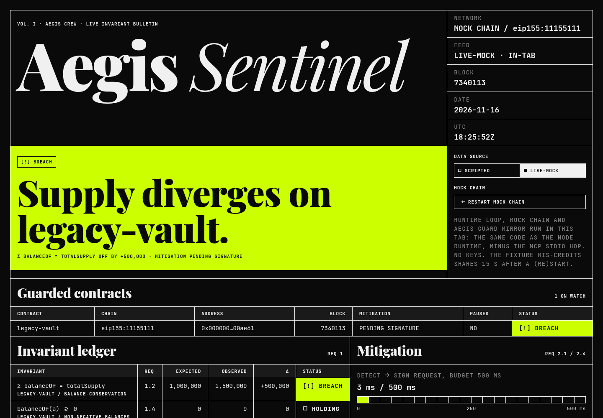

# AEGIS CREW

**Reads a dead 2019 smart contract, writes its spec, and guards it with no human key.**

[](https://github.com/g4stein/aegis-crew/actions/workflows/ci.yml)

Kiroween 2026, **Frankenstein** category. AEGIS CREW stitches together parts that were never built to work together:

- a 2019 Solidity vault (`pragma ^0.4.24`, `tx.origin` auth, reentrancy),
- Kiro's spec-driven agents, hooks, and steering,
- NEAR Chain Signatures, an MPC network that signs Ethereum transactions for a NEAR contract,
- a Rust guard contract that is the only path to that signer.

The result is one pipeline: legacy code goes in, and a verified emergency `pause()` comes out within milliseconds of a breach, with no private key anywhere in the loop.

**Try it:** [aegis-crew.vercel.app/?source=live-mock](https://aegis-crew.vercel.app/?source=live-mock). The whole pipeline runs in your browser tab: a breach fires 15 s after load and ends in a confirmed pause. Nothing to install.

| Part | What it does |
|---|---|
| [`aegis-forge`](aegis-forge/) | CLI. Parses legacy Solidity as data (never compiles or runs it), emits a JSON AST map, flags legacy risks, proposes invariants, and writes a Kiro modernization spec in EARS syntax. |
| [`aegis-sentinel`](aegis-sentinel/) | Dashboard + runtime. Enforces the invariants the Forge proposed, reads chain state through an MCP server, and on a breach requests a `pause()` from the Aegis Guard within 500 ms of detection. |
| [`contracts/aegis-guard`](aegis-sentinel/contracts/aegis-guard/) | NEAR contract (Rust). Builds the `pause()` transaction itself, runs 13 checks, pays the MPC deposit, and asks NEAR Chain Signatures to sign. The Sentinel's key can call nothing else. |

The Forge's output is the Sentinel's input: `aegis-forge/output/legacy-vault.invariants.json` defines the invariant the Sentinel enforces, and the dashboard shows that file's path and sha256.



---

## Quickstart

Requires Node 22+. Rust (cargo) is needed only for the Aegis Guard contract tests and to regenerate test vectors.

```sh
npm install        # also activates the pre-commit PBT guard and applies the parser patch
```

### Forge: ingest a legacy contract

```sh
npx aegis-forge ingest aegis-forge/input/legacy-vault.sol --force
# or: npm run -w aegis-forge ingest -- aegis-forge/input/legacy-vault.sol --force
```

Writes `aegis-forge/output/legacy-vault.{ast,invariants}.json` and `.kiro/specs/legacy-vault-modernization/{requirements,design,tasks}.md`. Without `--force` it refuses to overwrite an existing spec. With no file argument it ingests every `input/*.sol` that has no spec yet.

### Sentinel: scripted demo (browser only)

```sh
npm run -w aegis-sentinel dev        # open the printed URL, press "Simulate breach"
```

### Sentinel: live-mock (runtime + MCP server)

```sh
npm run -w aegis-sentinel build
npm run -w aegis-sentinel runtime    # open http://127.0.0.1:8787/?source=live-mock
```

The runtime spawns `aegis-sentinel/mcp/chain-state-server.mjs` over stdio. The mock chain mis-credits 500,000 shares 15 s after start (a reentrant `withdraw`); the runtime detects it, verifies and submits the pause, and the contract ends up paused. **Restart mock chain** replays it.

### Deployed dashboard

`vercel.json` builds the dashboard as a static site. Both data sources work there. With no Node runtime to reach, **Live-mock** runs the same runtime loop, mock chain, and Aegis Guard mirror inside the tab (masthead: `LIVE-MOCK · IN-TAB`), with the same bundled Forge invariants and sha256. Open [`/?source=live-mock`](https://aegis-crew.vercel.app/?source=live-mock): the breach fires 15 s after load and ends in a confirmed pause. The in-tab path skips only the MCP stdio hop and its JSON Schema check, and holds no keys. Locally, `?runtime=browser` forces it.

### Tests

```sh
npm run -w aegis-sentinel test:pbt   # P1–P12, P17–P20, env hardening + 310 Rust encoding vectors
npm run -w aegis-forge test:pbt      # P13–P16 + legacy-vault golden test
npm run -w aegis-sentinel test:e2e   # runtime -> MCP -> Aegis Guard (mirror) -> confirmed pause; in-tab runtime; bundle boundary
npm run -w aegis-sentinel test:guard # Aegis Guard contract: 18 Rust unit tests (needs cargo)
npm run -w aegis-sentinel typecheck && npm run audit:ui
npm run -w aegis-sentinel vectors    # regenerate EIP-1559 vectors (needs cargo)
npm run -w aegis-sentinel guard-vectors  # regenerate guard conformance vectors (needs cargo)
```

[`ci.yml`](.github/workflows/ci.yml) runs all of the above from a clean checkout on every push, checks that the Forge reproduces its committed output byte for byte, and builds `aegis_guard.wasm` with cargo-near.

### Testnet proof (Aegis Guard on NEAR testnet)

[`testnet-proof.yml`](.github/workflows/testnet-proof.yml) is a manual workflow that runs [`scripts/testnet/proof.mjs`](scripts/testnet/proof.mjs). On fresh accounts it:

1. creates the guard account, deploys the wasm, and initializes it in one transaction that adds no access key, so nobody holds a key to the guard;
2. creates a Sentinel account whose only key is a function-call key for `request_pause`;
3. allowlists the target and posts a fee quote (owner account);
4. sends `request_pause` from the Sentinel key with 0 deposit; the guard runs its 13 checks, pays the deposit, and calls `v1.signer-prod.testnet.sign`;
5. waits for the MPC signature and checks offline that the signed transaction is `pause()` to the allowlisted target and that its signer recovers to the MPC-derived address;
6. checks three refusals: a non-Sentinel caller, a replayed breach, and the Sentinel key calling an owner method.

It writes every explorer link to `.kiro/artifacts/testnet-proof.json`. To run it, add the repo secrets `NEAR_TESTNET_ACCOUNT_ID` and `NEAR_TESTNET_PRIVATE_KEY` (a testnet account with about 5 NEAR), then start the workflow from the Actions tab. **It has not run yet**; this README will link the transactions once it does.

---

## How Kiro was used

| Kiro feature | Artifact | What it does here |
|---|---|---|
| **Specs** | [`.kiro/specs/aegis-protocol/`](.kiro/specs/aegis-protocol/) | EARS requirements, design (architecture, interfaces, 20 correctness properties), and a task plan with every completed task checked off. |
| **Generated specs** | [`.kiro/specs/legacy-vault-modernization/`](.kiro/specs/legacy-vault-modernization/) | Written by the Forge CLI, not by hand. A golden test fails if anyone edits them. |
| **Steering** | [`architecture.md`](.kiro/steering/architecture.md) (always), [`ui-manifesto.md`](.kiro/steering/ui-manifesto.md) (fileMatch on Sentinel UI) | Pure core vs adapters, so property tests run headless; Editorial Brutalism rules for the dashboard. |
| **Hooks** | [`.kiro/hooks/`](.kiro/hooks/) | `pbt-guard` (PreToolUse on `git commit`) runs `vitest run tests/pbt` when a core or anything the suites depend on changes (tests, vectors, Forge schema/input/output) and blocks on failure; `spec-audit` (PostToolUse on writes) runs the manifesto audit; `archivist-intake` (PostFileCreate on `aegis-forge/input/*.sol`) starts the Archivist. `.githooks/pre-commit` applies the same PBT gate to commits made outside Kiro. |
| **Custom agents** | [`.kiro/agents/`](.kiro/agents/) | `aegis-archivist` (may run only the ingest CLI and write only spec/output paths), `aegis-verifier` (read-only, runs PBT), `aegis-sentinel` (MCP tools only, no shell, no writes). |
| **Crew** | [`.kiro/crew.yaml`](.kiro/crew.yaml), [`scripts/crew/install.sh`](scripts/crew/install.sh) | Manifest of the three-agent swarm; the script registers the intake schedule and the Sentinel heartbeat with Kiro Crew. |
| **MCP** | [`.kiro/mcp/chain-state-mcp.json`](.kiro/mcp/chain-state-mcp.json), [`.kiro/settings/mcp.json`](.kiro/settings/mcp.json) | Tool schema is the single source of truth: the server serves it verbatim and validates every input and output against it. |
| **Vibe sessions on top of specs** | `git log` | Specs set the contract; vibe sessions did the exploratory work: auditing the repo, diagnosing Vercel build failures, and the in-tab runtime. Every change still went through the PBT gate. |
| **Property-based testing** | `*/tests/pbt/` | 20 named properties, each tied to a requirement ID. Generated properties run 1,000 cases each; P20 replays fixed vectors produced by the Rust guard contract. |

### The hook → Archivist → Verifier chain, live

Creating `aegis-forge/input/legacy-vault.sol` fired `archivist-intake`. The `aegis-archivist` agent ran the real CLI, checked the EARS output, and reported that the Forge had **missed a reentrancy** in `deposit()` (`token.transferFrom` before state writes). Detector R4 was fixed to treat calls on contract-typed state variables as external calls, the spec was regenerated, and `aegis-verifier` ran both PBT suites (all green) and listed the Requirement 3 criteria that still lacked properties.

### Property tests that found real bugs

- **P9 `stops-when-paused`**, seed `209548967`, shrunk to `breach → paused_observed → timeout`: the state machine re-submitted a sign request after the contract was already paused. Fixed and kept as a regression example.
- **P15 `risk-detection`**, seed `713695097`: exposed a generator bug that silently skipped a pattern. Fixed and kept as a regression example.

### Mutation testing

Deliberate bugs were injected one at a time, and every one was caught:

- **TypeScript cores (14):** skip conservation, allow negative amounts, mutate input, ignore value or target in the gate, break RLP, swap fields, allow duplicate mitigations, ignore stale state, ignore paused, unsorted JSON, mis-parse `^` pragmas, disable R3, emit a non-EARS line.
- **Aegis Guard contract, Rust (10):** skip the selector, target, fee-cap, rate-limit, in-flight, or caller check; zero deposit; write state before checks; quote-age off-by-one; non-canonical `r`/`s`.
- **Guard mirror, TypeScript (12):** the same rule classes, plus domain ID, recovery ID, value, and chain. The first run let three through (quote-age off-by-one, in-flight, selector); P19's generators were strengthened until all were caught.

---

## Evidence

| Evidence | Where |
|---|---|
| Scripted dashboard: nominal, breach, contained | [`01`](.kiro/artifacts/screenshots/sentinel-01-nominal.png) · [`02`](.kiro/artifacts/screenshots/sentinel-02-breach.png) · [`03`](.kiro/artifacts/screenshots/sentinel-03-contained.png) |
| Live-mock dashboard (Node runtime + MCP): holding, breach, contained | [`04`](.kiro/artifacts/screenshots/sentinel-04-live-mock-holding.png) · [`05`](.kiro/artifacts/screenshots/sentinel-05-live-mock-breach.png) · [`06`](.kiro/artifacts/screenshots/sentinel-06-live-mock-contained.png) |
| Live-mock dashboard (in-tab runtime, static hosting): holding, breach, contained | [`07`](.kiro/artifacts/screenshots/sentinel-07-in-tab-holding.png) · [`08`](.kiro/artifacts/screenshots/sentinel-08-in-tab-breach.png) · [`09`](.kiro/artifacts/screenshots/sentinel-09-in-tab-contained.png) |
| Recorded runtime snapshots and log (7 ms detect-to-submit, 3.76 s to confirmed pause) | [`.kiro/artifacts/live-mock/`](.kiro/artifacts/live-mock/), produced by [`scripts/e2e/record-live-mock.mjs`](scripts/e2e/record-live-mock.mjs) |
| 310 cross-language encoding vectors (Rust `omni-transaction` ↔ TypeScript, byte for byte) | [`aegis-sentinel/tests/vectors/eip1559-pause.json`](aegis-sentinel/tests/vectors/eip1559-pause.json), from [`contracts/pause-tx`](aegis-sentinel/contracts/pause-tx/) |
| `omni-transaction` leading-zero finding: raw 32-byte `r`/`s` encode non-canonically for about 1 in 128 signatures, which Ethereum nodes reject. The crate strips leading zeros; vectors lock it in. | [`contracts/pause-tx/src/lib.rs`](aegis-sentinel/contracts/pause-tx/src/lib.rs) |
| `@solidity-parser/parser` 0.20.2 crashed without a location on some syntax errors; patched to report `line:column` | [`patches/@solidity-parser+parser+0.20.2.patch`](patches/@solidity-parser+parser+0.20.2.patch) |
| Aegis Guard conformance vectors: scripted scenarios run against the real contract (near-sdk mocked blockchain), replayed byte for byte by the TypeScript mirror (P20) | [`aegis-sentinel/tests/vectors/aegis-guard.json`](aegis-sentinel/tests/vectors/aegis-guard.json), from [`contracts/aegis-guard`](aegis-sentinel/contracts/aegis-guard/) |
| Forge output for the 2019-era vault: 9 risks (legacy pragma, `tx.origin` auth, unchecked call, 4× call-before-write), 1 balance invariant | [`aegis-forge/output/`](aegis-forge/output/), [`legacy-vault-modernization/requirements.md`](.kiro/specs/legacy-vault-modernization/requirements.md) |

---

## Security model

- **Keyless signing.** The target-chain key is never stored, loaded, or derived. NEAR Chain Signatures' MPC network signs for an address derived from the guard contract and a per-contract derivation path.
- **Aegis Guard contract.** The MPC `sign` method needs an attached deposit, and NEAR function-call keys cannot attach deposits. So the Sentinel's key can call only the guard's `request_pause(contract_id, breach_id)`; the guard builds the `pause()` transaction itself, enforces 13 checks on-chain (allowlist, target, chain, selector, value, fee caps, quote freshness, per-contract rate limit, no duplicate or in-flight request, balance), and pays the 1 yoctoNEAR deposit from its own balance. A stolen Sentinel key can at most pause allowlisted contracts, slowly.
- **The caller cannot choose the payload.** `broadcast_mitigation_payload` accepts only `contract_id`, `breach_id`, and `dry_run`. The server builds the transaction; the runtime re-encodes it, checks the hash, and runs its own gate before submitting.
- **Where the key lives.** `AEGIS_SIGNER_KEY` comes from `.env` (git-ignored; see [`.env.example`](.env.example)) and is read only by the chain-state server process. No tool returns it, so it never enters an agent's context, and the browser bundle contains no chain or signer code: [`tests/e2e/bundle-boundary.test.ts`](aegis-sentinel/tests/e2e/bundle-boundary.test.ts) walks the bundle's import graph and fails if it reaches the Node host, the chain/config/crypto adapters, the MCP server, or Node-only packages. The server also ignores unexpanded `${...}` placeholders passed by an MCP host, so a literal `"${AEGIS_SIGNER_KEY}"` can never override `.env`.
- **Defense in depth.** The pure core rejects any calldata other than `0x8456cb59`, any non-zero value, and any target or chain not on the allowlist (P6). EIP-1559 transactions carry `chainId`, and each contract and chain gets its own derivation path, so signatures cannot be replayed elsewhere.
- **Agents are least-privilege.** Solidity input is treated as data, never compiled or executed. The Sentinel agent has no shell and no write access.
- **Status.** The Aegis Guard contract is implemented, unit-tested in near-sdk's mocked blockchain, and builds to a 264 KB wasm with cargo-near in CI. The testnet deployment is scripted but has not run yet (task 5.5), and `near-workspaces` sandbox tests are still pending (5.3). Live EVM adapters are task 6. Today the full pipeline runs against the mock chain, with the guard enforced by its conformance-tested TypeScript mirror, both in the Node runtime and in the browser tab.

---

## License

[MIT](LICENSE) © 2026 g4stein
